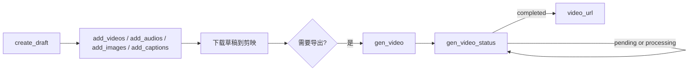

# 模型调用指南

> 摘自官方《模型调用指南》 https://docs.jcaigc.cn/capcut-mate/llm-guide.zh.md ，基地址 `https://capcut-mate.jcaigc.cn/openapi/capcut-mate/v1`。

## 硬规则

1. **Base URL** 必须是 `https://capcut-mate.jcaigc.cn`，路径前缀 `/openapi/capcut-mate/v1/`。
2. **时间单位是微秒**：1 秒 = `1000000`。例如 5 秒片段写 `start: 0, end: 5000000`。
3. **先 `create_draft`，后续每次写接口带上返回的 `draft_url`**。不要自己编 `draft_id`。
4. **列表字段多数是 JSON 字符串**，不是对象数组：`video_infos`、`audio_infos`、`image_infos`、`captions`、`effect_infos`、`filter_infos`；`keyframes` 例外：`add_keyframes` 传 JSON 字符串，`add_mask_keyframes` 必须传数组。
5. 剪映小助手线上服务仅 `gen_video`（0.3 元/分钟，VIP 0.24 / SVIP 0.18）与 `upload_file`（0.005 元/MB，单次最低 0.002 元）收费，需要 `apiKey`（UUID）。其余接口免费。文案生成、图像生成、视频生成、数字人、音乐生成与语音网关是独立服务，另行计费。
6. 导出是异步：`gen_video` 只表示任务已提交，必须轮询 `gen_video_status`。
7. **图层顺序**：先添加的在下层、后添加的在上层；音频是独立层，始终在最底层轨道；时间线重合会遮挡。
8. **只能通过接口生成草稿**：除下载器安装时的素材本地化改写外，不要直接修改剪映草稿文件
   （草稿文件是加密的）。需要调整时重新运行 `create_draft` + `add_*`；图片、视频、音频 URL
   可复用，非必要不要重新上传。
9. **字幕/时间线 ASR（autosubrt）是独立服务**：基地址 `https://autosubrt.jcaigc.cn`，路径前缀
   `/openapi/autosubrt/v1/`，按音频时长 0.00022 元/秒计费，需要 `apiKey`。`asr` / `asr_srt`
   返回**毫秒**，`asr_text_align` 返回**微秒**（可直接给 `add_captions`）。普通音频转文字走
   规则 12 的语音网关（默认 `volc.bigasr.auc_turbo`）。
10. **图像生成是独立网关**：基地址 `https://api.jcaigc.cn/v1`，`POST /v1/images/generations`，
    鉴权用 `Authorization: Bearer <apiKey>`，按张计费（0.12–1.12 元/张），同步返回图片 URL。
11. **视频生成是同一独立网关**：`POST /v1/video/generations` 提交，`GET /v1/video/generations/{task_id}`
    轮询；按秒计费，默认 `doubao-seedance-2.0` + 480P（0.45 元/秒）。异步任务要及时轮询，
    30 分钟未取结果会 `expired` 且不退预扣费用。
12. **语音网关也是同一独立网关**：ASR `POST /v1/audio/transcriptions` 默认 `volc.bigasr.auc_turbo`
    （0.00022 元/秒）；TTS `POST /v1/audio/speech` 默认 `seed-tts-2.0`
    （2.8 元/万字符）；声音复刻 `POST /v1/audio/voices` 默认 `cosyvoice-v3.5-plus`（9.9 元/个）。
    音色与模型必须配套。
13. **音乐生成也是同一独立网关**：`POST /v1/music/generations` 提交，
    `GET /v1/music/generations/{task_id}` 轮询；按次计费，默认 `minimax-music-2.0`（0.25 元/次）。
    失败全额退还，30 分钟未取结果会 `expired` 且不退预扣费用。
14. **数字人复用视频网关**：`video_url + audio_url` 用 `videoretalk`（0.08 元/秒）；
    `image_url + audio_url` 用 `wan2.2-s2v`（480P 0.5 / 720P 0.9 元/秒）。模型必须与入参匹配；
    图片说话音频 ≤20 秒，视频对口型 ≤120 秒。
15. **文案生成走大语言模型网关**：`POST /v1/chat/completions`，本技能只接入
    `gemini-3.5-flash-lite`（输入 2.25、输出 18.75 元/百万 token）。调用前告知按 token 计费，
    完成后按 `usage` 结算；事实性内容提醒用户核实。
16. **素材比例跟随草稿画布**：1080×1920 → 优先 9:16；1920×1080 → 优先 16:9；用户指定优先。
    图片用 `size`（非 Gemini）或 `aspect_ratio`（Gemini），视频用 `aspect_ratio`，
    数字人选择同方向的源图片/视频。

## 默认工作流

0. 本地素材：`POST /upload_file`（multipart，收费 0.005 元/MB）换成公网 URL（签名 URL 默认 7 天；仅下载草稿触发下载，`add_*` 只登记 URL）
0.5 需要配图时：`POST https://api.jcaigc.cn/v1/images/generations` 生成图片（按张收费），拿 `data[].url`
1. `POST /create_draft` → 拿到 `draft_url`
2. 按需要多次调用 `add_videos` / `add_images` / `add_audios` / `add_captions`
3. 可选：`add_effects` / `add_filters` / `add_keyframes` / `add_masks`
4. 默认下载草稿到本机剪映草稿目录，并告诉用户可以用剪映打开草稿查看成片
5. 询问用户是否需要自动导出成片；需要时要求提供 `apiKey`（不知道从哪里获取时提示 <https://jcaigc.cn>）
6. `POST /gen_video`（线上导出带 `apiKey`）
7. 每 3–5 秒 `POST /gen_video_status`，直到 `status` 为 `completed` 或 `failed`
8. 成功后使用响应里的 `video_url`



## 可选：图像生成（独立网关）

需要配图/封面时，`POST https://api.jcaigc.cn/v1/images/generations`，
请求头 `Authorization: Bearer <apiKey>`。**默认模型 `doubao-seedream-5-0-flash`（0.12 元/张）**；
用户未指定时用它，调用前告知单价、张数与预计费用，并说明可以换其它模型。

```json
{
  "model": "doubao-seedream-5-0-flash",
  "prompt": "窗台上打盹的橘猫，晨光，浅景深",
  "size": "1080x1920",
  "n": 1
}
```

响应同步返回 `data[].url`，可直接作为 `add_images` 的 `image_url`。按张计费，`n` 张就是
`单价 × n`。Gemini 两条支持参考图改图、每次只生成 1 张、结果 URL 默认 7 天有效。
模型清单可用 `GET https://api.jcaigc.cn/v1/models` 查询。详见 [generate-image.md](generate-image.md)。

## 可选：视频生成（独立网关）

需要视频片段时，`POST https://api.jcaigc.cn/v1/video/generations`，
请求头 `Authorization: Bearer <apiKey>`。**默认模型 `doubao-seedance-2.0` + `480P`（0.45 元/秒）**；
用户未指定时用它，调用前告知模型、分辨率、时长与预计费用，并说明可换其它模型/分辨率。

```json
{
  "model": "doubao-seedance-2.0",
  "prompt": "镜头缓慢推进，雨后的城市街道，霓虹倒影",
  "resolution": "480P",
  "aspect_ratio": "9:16",
  "duration": 5
}
```

提交后返回 `task_id`，再 `GET /v1/video/generations/{task_id}` 轮询，`succeeded` 后读
`video_url` 或 `data[0].url`。按秒计费；`failed` 全额退还，30 分钟未取结果会 `expired`
且不退预扣费用。完整模型/分辨率/价格见 [generate-video.md](generate-video.md)。

## 可选：语音（ASR / TTS / 声音复刻，独立网关）

网关基地址 `https://api.jcaigc.cn/v1`，按默认模型调用：

- **ASR 默认 `volc.bigasr.auc_turbo`**（0.00022 元/秒）：`POST /v1/audio/transcriptions`，
  multipart 传 `file` 或 `file_url`；可选 `response_format=verbose_json` 拿分句时间线。
- **TTS 默认 `seed-tts-2.0` + `zh_female_vv_uranus_bigtts`**（2.8 元/万字符）：
  `POST /v1/audio/speech`，JSON 传 `model` / `input` / `voice`，返回音频二进制。
- **声音复刻默认 `cosyvoice-v3.5-plus`**（9.9 元/个）：`POST /v1/audio/voices`，multipart 传
  参考音频 `file`；拿到 `voice_id` 后用同一个模型合成。

音色必须配套：`seed-tts-2.0` 只能配豆包 `*_uranus_bigtts`；`qwen3-tts-flash` 只能配千问内置音色；
`cosyvoice-v3.5-*` 没有系统音色，需先复刻。用户可换其它模型，但调用前要告知模型与费用。
详见 [voice-transcribe.md](voice-transcribe.md)、[voice-tts.md](voice-tts.md)、
[voice-clone.md](voice-clone.md)、[voice-voices.md](voice-voices.md)。

## 可选：文案生成（大语言模型网关）

写口播/视频文案时，`POST https://api.jcaigc.cn/v1/chat/completions`，
请求头 `Authorization: Bearer <apiKey>`。**本技能只接入 `gemini-3.5-flash-lite`**；
输入 2.25、输出 18.75 元/百万 token，按 `usage` 结算。

```json
{
  "model": "gemini-3.5-flash-lite",
  "messages": [
    {"role": "system", "content": "你是短视频口播文案编剧。输出口语化、短句、可直接朗读的中文文案。"},
    {"role": "user", "content": "主题：新手如何拍出稳定的手机视频。目标时长：30 秒。语气：自然亲切。"}
  ],
  "stream": false,
  "temperature": 0.7
}
```

正文在 `choices[0].message.content`；计费用量在 `usage`。文案可继续交给语音合成/数字人，
或作为字幕文本。详见 [generate-script.md](generate-script.md)。

## 可选：数字人（复用视频网关）

数字人复用 `POST https://api.jcaigc.cn/v1/video/generations`，方案由入参决定：

- **视频对口型**：`{"model":"videoretalk","video_url":"...","audio_url":"..."}`，
  0.08 元/秒，只换口型。
- **图片说话**：`{"model":"wan2.2-s2v","image_url":"...","audio_url":"...","resolution":"480P"}`，
  480P 0.5 / 720P 0.9 元/秒。

提交后返回 `task_id`，用同一接口的 `GET /v1/video/generations/{task_id}` 轮询。
图片说话音频 ≤20 秒，视频对口型 ≤120 秒；失败全额退还，30 分钟未取结果会 `expired`。
详见 [digital-human.md](digital-human.md)。

## 可选：音乐生成（独立网关）

需要 BGM/歌曲时，`POST https://api.jcaigc.cn/v1/music/generations`，
请求头 `Authorization: Bearer <apiKey>`。**默认模型 `minimax-music-2.0`（0.25 元/次）**；
用户未指定时用它，调用前告知单次价格，并说明可换 `minimax-music-3.0`（1 元/次）。

```json
{
  "model": "minimax-music-2.0",
  "prompt": "轻快的民谣流行，木吉他，男声温柔治愈",
  "lyrics": "[Verse]\n晨光落在安静的窗台",
  "output_format": "mp3"
}
```

提交后返回 `task_id`，再 `GET /v1/music/generations/{task_id}` 轮询，`succeeded` 后读
`audio_url` 或 `data[0].url`。按次计费；失败全额退还，30 分钟未取结果会 `expired`
且不退预扣费用；音频地址默认 7 天有效。完整说明见 [generate-music.md](generate-music.md)。

## 可选：字幕/时间线 ASR（autosubrt，独立服务）

需要从音频生成字幕时：

1. 已有人工校对文案：`POST https://autosubrt.jcaigc.cn/openapi/autosubrt/v1/asr/text/align`
   传 `audio_url` + `text` + `max_chars_per_line`，返回的 `timelines` 是微秒，直接作为
   `add_captions` 的 `start` / `end`。
2. 没有文案：`POST .../asr` 拿分句与逐字时间线（毫秒），或 `POST .../asr/srt` 直接拿 SRT 文件本体。
3. 只要纯文本：`POST .../asr/text`。

ASR 按音频时长 0.00022 元/秒计费，需要 `apiKey`；调用前先告知用户。详细参数见
[asr.md](asr.md) / [asr-text.md](asr-text.md) / [asr-srt.md](asr-srt.md) / [asr-text-align.md](asr-text-align.md)。

## 字幕默认规则

用户没有特别要求时：

- **普通字幕**：`font_size: 8`、`font: "金陵体"`、`text_color: "#000000"`、
  `border_color: "#ffffff"`、`has_shadow: true`；每行 **≤15 字**。
- **标题/花字**：`font_size: 16`；每行 **≤8 字**；花字/文字模板自带配色会覆盖颜色/描边/阴影，
  但字号与每行字数仍按 16 / 8。
- 字幕不含标点：先按标点断句并去掉标点，仍超长再硬切，硬切不要拆开数字和英文单词。
- 画布为 1080×1920 时，字幕位置默认 `transform_x: 0`、`transform_y: -800`。
- 用户可指定其它字号、字体、颜色、描边或阴影，用户要求优先。

## 不要主动调用

以下接口是给扣子 / n8n 拼 JSON 字符串用的，原生 function calling **不要**调用：

* `timelines`、`audio_timelines`
* `video_infos`、`audio_infos`、`imgs_infos`、`caption_infos`、`effect_infos`、`filter_infos`、`keyframes_infos`
* `str_to_list`、`str_list_to_objs`、`objs_to_str_list`

直接构造 JSON 字符串传给 `add_*` 即可。

## 最小示例：竖屏短视频

```bash
# 1. 创建 1080x1920 草稿
curl -X POST https://capcut-mate.jcaigc.cn/openapi/capcut-mate/v1/create_draft \
  -H "Content-Type: application/json" \
  -d '{"width":1080,"height":1920}'

# 2. 添加 5 秒视频（把 YOUR_DRAFT_URL 换成上一步的 draft_url）
curl -X POST https://capcut-mate.jcaigc.cn/openapi/capcut-mate/v1/add_videos \
  -H "Content-Type: application/json" \
  -d '{
    "draft_url": "YOUR_DRAFT_URL",
    "video_infos": "[{\"video_url\":\"https://example.com/clip.mp4\",\"start\":0,\"end\":5000000}]"
  }'

# 3. 提交导出
curl -X POST https://capcut-mate.jcaigc.cn/openapi/capcut-mate/v1/gen_video \
  -H "Content-Type: application/json" \
  -d '{"draft_url":"YOUR_DRAFT_URL","apiKey":"YOUR_UUID_API_KEY"}'

# 4. 查询状态，直到 completed
curl -X POST https://capcut-mate.jcaigc.cn/openapi/capcut-mate/v1/gen_video_status \
  -H "Content-Type: application/json" \
  -d '{"draft_url":"YOUR_DRAFT_URL"}'
```

## 状态机

| status | 含义 | 下一步 |
|--------|------|--------|
| pending | 排队中 | 继续轮询 |
| processing | 渲染中 | 继续轮询 |
| completed | 成功 | 读取 `video_url` |
| failed | 失败 | 读取 `error_message`，不要死循环 |

## 相关文档

* [精简契约](llm-contract.md)
* [发现入口 llms.txt](https://docs.jcaigc.cn/llms.txt)
* [创建草稿](create-draft.md)
* [生成视频](gen-video.md)
* [查询导出状态](gen-video-status.md)
